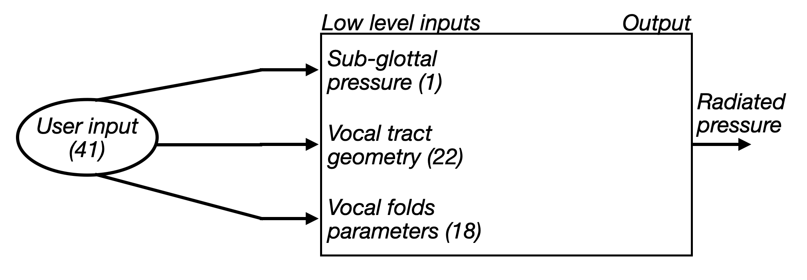
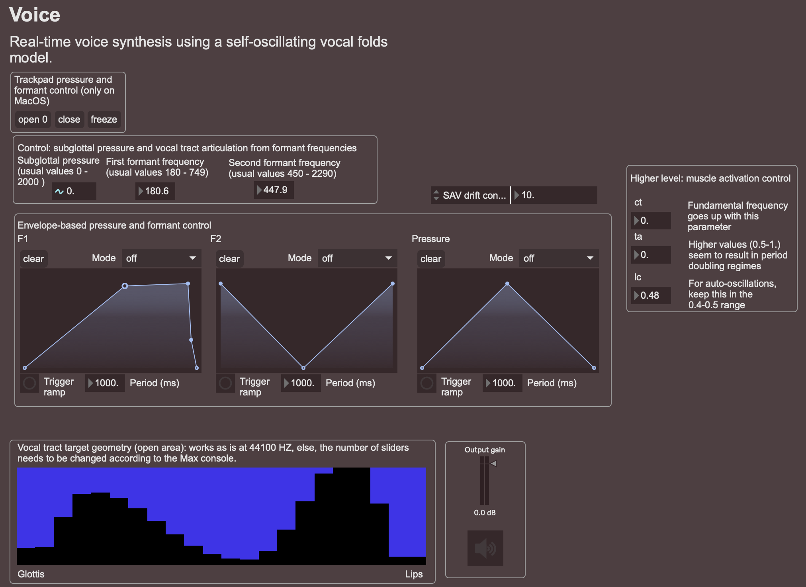

# Phonos-tilde

Max-MSP objects based on the [phonos](https://github.com/Ircam-RnD/phonos) (Time domain Acoustic Real-Time Engine) library for audio synthesis based on physical modeling. As of now, contains almost exclusively an object related to voice synthesis named ``phonos.voice~``.


## Contents

### Overview patch

The overview patch should appear in the `Extras` window of Max as `phonos-Overview`. From there, you can directly open a few demo patches. 

### phonos.voice~

The voice object is the main synthesis object of the package. It consists of a physical modeling based object for vocal synthesis. If you are interested in knowing more about the model and algorithm, you'll need to wait until I'm not lazy anymore for me to publish a paper on that... In the meantime, some material is available in the [phonos documentation](https://ircam-rnd.github.io/phonos/theory/Physical-components/00-webster/). 

At its core, the model can be viewed as a blackbox synthesis block:



The object wraps around this diagram, and, while it gives access to the low level input parameters, it also provide a higher level, reduced-order parameter set consisting of 3 muscle activation parameters instead of the 18 vocal folds parameters, and 2 formant frequencies for tuning the vocal tract geometry. The multichannel output also contains radiated pressure as well as vocal fold masses displacements, glottal flow, and glottal pressure drop.

Here is an example interface built around the object:



### phonos.trackpad

The trackpad object only works for MacOS. It outputs a raw access to trackpad measurements (finger positions, pressure, orientation, size...). It supports up to 11 fingers (yes, some guys at Apple apparently thought humans have 11 fingers) in multi-finger mode (the single finger mode allows to "focus" on a single finger). Here is an example of finger touches visualized as ellipses with 4 fingers engaged:


The object can be sphonosd by sending it the message `open 0` and stopped by sending it `stop 0`. Using a higer interger value is possible when external trackpads are connected (multiple trackpads should be able to work together, this is however untested as I don't have access to an external trackpad). The `freeze` message allows to disable the use of the trackpad for anything other than interactions through the objects (i.e. the cursor disappears, as well as MacOS navigation gestures). Hitting the escape key will release the cursor.

>[!CAUTION] 
> Due to the lack of better solution, the freeze message internally blocks all communication related to the MacOs Dock process by execution the command `pgrep -x Dock | xargs kill -s STOP`. As a result, navigation gestures (2 or 3 finger swipes) are deactivated, as well as access to the dock. If you close max normally, everything will come back to normal. However, if Max were to crash, you should recover the use of the mouse cursor but not the Dock-related features, which is REALLY panicking when it happens. The solution in that case is to open a terminal (the `cmd+space` spotlight research + typing `terminal` will do so) and execute the command `pgrep -x Dock | xargs kill -s CONT`. Restarting the computer will also fix the problem in a desperate scenario.

## Building the package

If you wish to build the max package on your computer, you can do so by cloning this repository. After that, you should intialize the needed dependencies included as git submodules by using the following command:
```
git submodule update --init --recursive
```

Assuming you have the necessary dependencies for the phonos library (mainly Eigen, see the [getting sphonosd](https://ircam-rnd.github.io/phonos/examples/Getting-sphonosd/) for more info), you should be able to build the externals by running
```
mkdir build 
cd build
cmake ../src/phonos-tilde -DCMAKE_BUILD_TYPE=Release 
make
cd ..
```
from the root. After doing so, the built externals must ahve appeared in `package/externals` such that you can copy the package directory to your max package directory and use the package. If you build for windows, you should remove the phonos.trackpad directory before building as it only works on macos.

## Authors

The package was initially developed as part of the AVATARS ANR research project. Research was conducted by Thomas Risse, Thomas Hélie, Fabrice Silva and Stefan Bilbao. Code development was made by Thomas Risse and Aloïs Cerbu. Presets for the voice object were kindly given by Tom Mudd. 